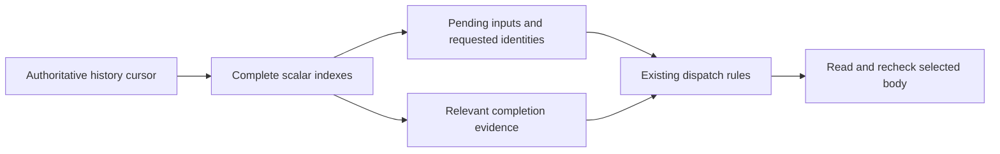

# Scalar evidence for Roost dispatch

Status: proposed
Translation: current

[中文](2026-10-22-roost-dispatch-scalar-projection.zh.md)

## Abstract

The dispatcher still read and copied the entire transcript to find one input,
despite the incremental writer and windowed renderer. This change queries a
cursor-fenced local projection of pending inputs, requested identities and their
completion evidence, then reads only the selected input body. Existing selection,
repair, queue, cancellation and RPC deduplication rules remain authoritative.
Missing or invalid projections require bounded-page reconstruction; the intended
history-scaling benefit remains subject to the measurements below.

## Decision and boundaries

The [previous audit](2026-10-22-roost-end-to-end-incremental-mutations.md#coverage-gaps-and-source-interpretation)
identified the retained `checkHistoryAndQueue → readHistory` path. Its backend
call comes from #1181; the current full Roost implementation comes from #1329.
The earlier write/projection optimizations did not remove this consumer.

- A dispatch entry contains identity, role, status/legacy `read`, user linkage,
  end time and the steer-delivery flag. It carries no prompt, items, tools, plan
  or provider payload. Loro projects the same fields from its shallow directory.
- Native-local derived tables hold logical position/segment references, pending
  identities and completed assistant evidence. An exact event cursor and count
  certify a complete projection. The private row cache is bounded and public
  results are detached. A changed foreign checkpoint invalidates cached rows.
- Ordinary content edits advance the projection in the existing certified Native
  derived-index transaction, comparing the previous projection marker. Scalar
  changes update only affected rows. A deletion or an uncertified batch leaves
  the old marker unusable until guarded index publication; it is never accepted
  merely because the content command returned successfully.
- A confirmed linear append contributes its certified position and physical
  reference. Forks, generation replacement, foreign events and uncertain coverage
  refuse incremental advancement. Missing, interrupted or malformed indexes are
  reconstructed from coherent bounded pages under the existing owner write queue,
  with a final event-cursor check before publishing the complete marker. Repair
  visits old bodies once; a valid persisted index does not. This is derived-cache
  repair, not another message format or compatibility reader.
- Dispatch preserves chronological last-copy ownership, prepared-input activation,
  legacy unread inputs, refused/applied steer distinctions, imported replay
  exclusion, permanent missing-history exclusions and terminal repair evidence.
  Native selection and selected-body hydration run under the same before/after
  event-cursor fence. Loro captures both synchronously before yielding; an async
  owner must supply its own coherent observation rather than stitch independent
  reads together. Changed observations retry within a finite bound. Queue
  promotion refreshes its exact current head and
  preserves older terminal duplicate witnesses. RPC stash identities participate
  in the same evidence query.
- Cancellation checks and pending-inbox enumeration use the same scalar evidence.
  Explicit replay, export, fork and history replacement retain full-read semantics.
  No Native/SDK, wire format, signing, retention or durability change is introduced.

## Ownership and failure behavior

History/control updates retain their existing owners and order. Projection repair
shares the Node history owner's serialized write queue; disposal drains that queue
before releasing the Native lease. A caller does not gain a second history writer
or cancellation authority over shared work. A partial repair has no valid marker;
uncertain data cannot authorize dispatch. A cache maintenance failure does not
erase a durable content receipt: the next read repairs authoritative state.

This is feature/fix mode under the Effect skill. Pure selection/index planning
stays ordinary TypeScript; the existing Promise backend/dispatcher boundary and
its unfinished lifecycle dependencies remain unchanged. The L6 migration unit is
not claimed complete, and no migration-ledger ownership changes are made.

## Validation and limits

Validation and fixed-prefix performance measurements are in progress. No new
performance or correctness completion claim is made before those results.

Use the [existing validation workflow](../../../docs/roost-validation.md) and its
full report contract. Include actual dispatcher selection, persisted-index reopen,
index repair, old pending inputs outside the latest window, completed/removed
branches, row ownership, retries and queue/RPC behavior. Report repair separately
from valid-index cold open and ordinary selection. Expensive scale runs remain
manual; timings are not CI assertions.
