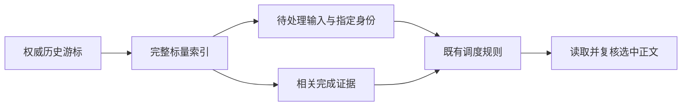

# Roost 调度的标量证据

Status: proposed
Translation: current

[English](2026-10-22-roost-dispatch-scalar-projection.md)

## 摘要

写入已增量化、展示已分页，但调度器寻找一条输入时仍读取并复制完整历史。本次改为
查询由事件游标约束的本地投影，取得待处理输入、指定身份及其完成证据，再只读取选中
输入的正文。原有选择、修复、队列、取消和 RPC 去重规则继续作为依据。投影缺失或
无效时按有界页面重建；历史长度扩展的预期收益仍需以下测量验证。

## 决策与边界

[此前审查](2026-10-22-roost-end-to-end-incremental-mutations.zh.md#缺测项与源码解释)
发现仍存在 `checkHistoryAndQueue → readHistory`。后端调用来自 #1181，当前 Roost
全文实现来自 #1329；此前的写入和投影优化没有移除此消费者。

- 调度条目只包含身份、角色、状态及旧 `read` 字段、关联 user、结束时间和 steer
  交付标记，不包含提示词、消息项、工具、计划或 provider 内容。Loro 从浅目录投影
  相同字段。
- Native 本地派生表保存逻辑位置/分段引用、待处理身份和已完成 assistant 的证据。
  精确事件游标与数量约束完整投影，私有行缓存有界，公开结果脱离内部引用。外部
  检查点变化会使旧行缓存失效。
- 普通内容编辑在既有、经证明的 Native 派生索引事务中推进投影，并比较上一投影
  标记；标量变化只更新受影响行。删除或未获得证明的批次，会让旧标记保持不可用，
  直到受保护的索引发布完成，不能仅凭内容命令返回成功就接受缓存。
- 确认的线性追加使用已证明的位置与物理引用。分支替换、存储代际替换、外部事件或
  覆盖不确定时不做增量推进。缺失、中断或损坏的索引在既有 owner 写队列中按一致的
  有界页面重建，最终核对事件游标后才发布完整标记。修复会访问一次旧正文；有效的
  持久化索引不需要。这是派生缓存修复，没有新增消息格式或兼容读取器。
- 调度保留按时间选择最后一份身份、prepared 输入的激活条件、旧未读输入、拒绝与
  已应用 steer 的区别、导入重放排除、永久缺失历史排除和终态修复证据。选中正文
  与选择过程受同一组读取前后事件游标约束。Loro 在让出执行权前同步取得两者；异步
  owner 必须提供自身的一致观测，不能拼接独立读取。变化时有限重试。队列提升重新
  读取当前队首的精确身份，并保留
  更早的终态重复记录。RPC 暂存身份也进入相同的证据查询。
- 取消检查和待处理收件箱枚举使用同一标量证据。显式重放、导出、fork 和历史替换
  保留全文读取语义。不改变 Native/SDK、线格式、签名、保留策略或持久化保证。

## 所有权与失败行为

历史和控制更新保留既有 owner 与顺序。投影修复共享 Node 历史 owner 的串行写队列，
释放 Native 租约前按既有销毁流程排空队列。调用者不会获得第二个历史写入者或取消
共享工作的权限。未完成的修复没有有效标记，不确定数据不能授权调度。缓存维护失败
不会抹掉已持久化的内容收据；后续读取从权威状态修复。

按 Effect skill 的 feature/fix 模式处理。纯选择与索引计划保留普通 TypeScript，
现有 Promise 后端/调度边界及其未完成的生命周期依赖保持原状。不宣称完成 L6 迁移，
不改变迁移台账中的所有权事实。

## 验证与限制

正确性与固定历史前缀的性能测量正在进行，结果完成前不宣称新的性能或正确性结论。

复用[既有验证流程](../../../docs/roost-validation.md)及完整报告要求。覆盖实际调度
选择、持久化索引重开、索引修复、最新窗口外的旧待处理输入、完成/移除的分支、行
所有权、重试和队列/RPC 行为。修复与有效索引的冷打开、普通选择分开报告。大规模
测量保留手动运行，不把耗时门槛放进 CI。
