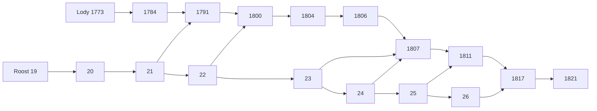

# Joint review of the Roost and Lody PR stacks

Status: proposed
Translation: current

[中文](2026-10-22-roost-pr-stack-integration.zh.md)

## Abstract

Eight open Roost PRs and ten open Lody PRs form two dependent stacks. Each tip already contains its earlier PRs, so combining their patches again would duplicate work. Roost's tip includes its latest main; Lody's tip merges cleanly with 27 newer main commits, but both edit ACP history semantics and require joint behavioral verification. Validate the two complete tips against current main before merging, then publish one matching Roost release and pin it in Lody. Registry CI currently cannot validate that pair because the new APIs have not been released; a successful source-linked run cannot remove that gate.

## Scope and source identity

Snapshot: 2026-10-22. Read-only GitHub metadata is retained outside Git with exact head/base hashes and check URLs. Existing PR branches and publication/deployment state are unchanged.

- Roost main: `1b6df6199ca2973efd6912f2e7611ba306e9aaa3`.
- Roost stack tip, [#26](https://github.com/loro-dev/roost/pull/26): `d4b07d48d53036da824372d5531f41da1fce02d2`.
- Lody main: `957b513ee391c5b69101ae3d22ee353f1d6f4b20`.
- Lody stack tip, [#1821](https://github.com/LodyAI/Lody/pull/1821): `d494724c30e4389148b81762162436d0b6063450`.
- Common Lody base: `a8cffe6f1be2a7b6983770afdebe5231b0a7ae10`.
- Local Lody integration branch: `codex/roost-stack-integration` in a separate clone. Initial merged source tree: `d6aca152c66e6356e8150c2c60affc1c62213f9c`.

This is dependency/integration review, not a new full line-by-line correctness certification or a performance claim. Prior accepted benchmark scope and gaps remain in the [validation guide](../../../docs/roost-validation.md) and its owning reports.

## Inventory and order

All entries below are open at the snapshot. Roost #19 is ready for review; the other 17 are drafts. The dependency column includes cross-repository API or SDK companions; within each stack every previous head is an ancestor of the next one.

| PR                                                     | Responsibility                                         | Prerequisite         | Head           |
| ------------------------------------------------------ | ------------------------------------------------------ | -------------------- | -------------- |
| Roost [#19](https://github.com/loro-dev/roost/pull/19) | Bounded inline projection                              | main                 | `0f81d7b12960` |
| Roost [#20](https://github.com/loro-dev/roost/pull/20) | Omit unused Native outbox copies                       | #19                  | `60f6b160cfc0` |
| Roost [#21](https://github.com/loro-dev/roost/pull/21) | Compact events and atomic local commit metadata        | #20                  | `4afe55a11d62` |
| Roost [#22](https://github.com/loro-dev/roost/pull/22) | Bounded packed SQLite log blocks; final container v9   | #21                  | `3068595c7b31` |
| Roost [#23](https://github.com/loro-dev/roost/pull/23) | Bounded sealed page-body cache                         | #22                  | `c40524ae7a52` |
| Roost [#24](https://github.com/loro-dev/roost/pull/24) | Remove redundant history catch-up round trips          | #23                  | `f4cc6b837eb2` |
| Roost [#25](https://github.com/loro-dev/roost/pull/25) | Conditional atomic derived checkpoints                 | #24                  | `ff1a639f930c` |
| Roost [#26](https://github.com/loro-dev/roost/pull/26) | Private checkpoint and branch-directory evidence       | #25                  | `d4b07d48d530` |
| Lody [#1773](https://github.com/LodyAI/Lody/pull/1773) | Compact agent replay receipts                          | main                 | `ce653a2199e9` |
| Lody [#1784](https://github.com/LodyAI/Lody/pull/1784) | Compact renderer change receipts                       | #1773                | `e920a7830d4e` |
| Lody [#1791](https://github.com/LodyAI/Lody/pull/1791) | Commit renderer metadata with content                  | #1784; Roost #21     | `061460cb7406` |
| Lody [#1800](https://github.com/LodyAI/Lody/pull/1800) | Packed-storage contract assertions                     | #1791; Roost #22     | `8e3375961a77` |
| Lody [#1804](https://github.com/LodyAI/Lody/pull/1804) | Reuse unchanged owner projections                      | #1800                | `2cfda8cfd2dd` |
| Lody [#1806](https://github.com/LodyAI/Lody/pull/1806) | Install certified text projections                     | #1804                | `af7e50bf7442` |
| Lody [#1807](https://github.com/LodyAI/Lody/pull/1807) | Reuse sealed projections and avoid seal window reload  | #1806; Roost #23/#24 | `bab14a8f424c` |
| Lody [#1811](https://github.com/LodyAI/Lody/pull/1811) | Fuse content, SDK progress and staged goal             | #1807; Roost #25     | `f06b820f3628` |
| Lody [#1817](https://github.com/LodyAI/Lody/pull/1817) | Carry semantic mutations through private projections   | #1811; Roost #26     | `435148029bff` |
| Lody [#1821](https://github.com/LodyAI/Lody/pull/1821) | Use scalar dispatch indexes instead of full transcript | #1817                | `d494724c30e4` |

Roost #15–#18 and Lody #1735/#1737/#1765 are already merged and are not additional patches to apply. Lody [#1483](https://github.com/LodyAI/Lody/pull/1483) only removes an unused `readGoalProjection` import: current main already has no such import, while the new stack imports and uses it in a behavioral test. Treat that old cleanup as obsolete; do not apply it to the new stack. No PR is closed by this audit.

## Conflict assessment

- Roost has 14 stack-only commits and no main-only commits. Its tip includes main, and all eight adjacent head ancestry checks pass.
- Lody has 24 stack-only and 27 main-only commits. All ten adjacent head ancestry checks pass. An actual local `merge --no-commit --no-ff` succeeds without manual resolution.
- The three files changed on both Lody sides are `AGENTS.md`, `session-execution-service.ts` and shared `acp/history-apply.ts`.
- Main's runtime-security floor remains in the combined instructions. Validation uses Node 24.22.1 rather than bypassing the new gate.
- Main's authored-prompt title, inbox admission/recovery and detached Code Collab changes are retained alongside body-free pending-inbox reads in session execution.
- Main #1805 adds one bounded tool-storage projection for root and normalized child tools. The stack's immutable planner invokes the same `NotificationOnHistoryApplier`, so its mutation tracking must preserve that new projection. Existing child-tool/storage-policy and immutable-plan tests are the joint behavioral boundary.

The first docs check also exposed a real combined gate failure: root `AGENTS.md` is 8,137 bytes on main and 8,185 on the stack, but 8,230 after merging; each side fits alone while the union exceeds the 8,192-byte limit. The added root-level Roost report rule is unnecessary: the existing validation guide already owns the requested report contract. The local integration copy removes that addition and retains main's instructions verbatim, including the complete Node security floor wording. It is 8,137 bytes; no new product requirement warrants another root rule. This documentation-only resolution has not been applied to existing PR branches.

Repeated edits to Native transaction code, SDK checkpoint logic, Lody owner projections and the large history contract suite are intentional dependencies, not independent patches that Git needs to choose between. Textual merge success does not establish transaction/proof, retry or recovery correctness. GitHub MERGEABLE is relative to each PR's declared parent branch, not a certification of the whole stack against main. Lody #1800 is required test adaptation, not another runtime optimization: old direct SQL scans cannot establish retained-update coverage after Roost #22 packs the rows.

## Current CI and release gates

Roost #26 has successful Rust/SDK and all six Native platform build/test jobs. Its remaining failed job is [release preparation](https://github.com/loro-dev/roost/actions/runs/39726241452/job/119653660877): npm dry-run rejects reusing the already published `0.2.0`. Earlier #23/#24 platform failures must be distinguished from this release gate; downloaded failure logs identify registry/pnpm acquisition failures rather than runtime assertions.

Lody [#1821 static checks](https://github.com/LodyAI/Lody/actions/runs/39758120547/job/119755205267) and [desktop smoke build](https://github.com/LodyAI/Lody/actions/runs/39758120634/job/119755252945) fail on missing `readCommitMetadata`, `annotateCommit`, `commitMetadataAfter`, `commitContentBatch`, `advanceActiveBranchDirectory`, and Native capability types. The lockfile still installs published 0.2.0. The same release dependency starts at #1791; #1773/#1784 do not show that failure at their own heads. Local source links are test setup only, not an installable release or CI fix.

Final combined Rust storage accepts fresh/container-v9 databases only; npm 0.2.0 used v4. There is no migration, automatic deletion, or legacy reader. Preserve old data with its matching old runtime. The previous user decision to use fresh experimental data does not authorize deleting any live database. Replicated wire v1 remains separate from this local-layout break.

## Joint verification

Frozen installation of the merged latest-main graph succeeds on Node 24.22.1, pnpm 10.20.0. Only this clone's CLI Roost symlinks are overridden; shared resolves inside the merged clone. Initial runtime checks use the built source SDK/Native; final Native consumer checks use installed candidate tarballs. Native and SDK were rebuilt from the exact Roost tip. The verified addon SHA-256 is `524c5497695dc4e2502d60aa0b6419d0cc6cf35bb30cccb8b7b5cc8df52b3ced`; the complete build-input manifest is outside Git.

| Check                                                                         | Combined-source result                        |
| ----------------------------------------------------------------------------- | --------------------------------------------- |
| SDK type check/build                                                          | Passed                                        |
| Native complete `npm test` (storage/recovery, sync and release unit fixtures) | 59 passed, zero skipped                       |
| SDK history (Chromium, WebKit and process host)                               | 164 passed, zero skipped                      |
| Lody root check                                                               | In progress; all workspace type checks passed |
| Root format and final docs check                                              | Pending final run                             |

The initial Native run used an unverified older adjacent addon and failed the reply protocol. It is excluded, its log is retained, and one real SDK write/reopen passed after rebuilding before the complete runs. Direct release-unit invocation also lacks npm fixture setup; the complete `npm test` above supersedes it. Missing Kimi/Pi source checkouts caused link-check errors until their exact pinned submodules were populated without installing or consuming their runtimes. These are setup corrections, not product regression claims; the reproducible guide now identifies the build-provenance and npm-fixture requirements.

The original root `pnpm check` exits nonzero because three Electron staging fixtures expect an installed host platform package that a source link does not contain. No runtime fix was made. Six genuine platform artifacts from [Roost #26 CI](https://github.com/loro-dev/roost/actions/runs/39726241452) were assembled through the existing release script. Their PR merge revision `6ef36e4cc242ad5fe4f5da06202feea93eba7dd3` has exactly the same tree as the Roost tip (`6e395f1d8f8d9ccdf2f2cd86b639cf2c728b4a1f`). A private offline install selects only main plus darwin-arm64; its addon SHA-256 is `cd399a4a7ad7d3483c222cae048ff46473dcc708ae9ced4df21bb7c27418e324`. After switching this clone's Native link, the complete Electron suite and eight owning CLI suites pass. Every root post-test gate was run separately and passed; the unrelated successful root suites were not repeated. The original failed root log remains part of the evidence, not relabeled as a green command. Other root skips are RPC 3 and platform 1. Desktop application E2E/build and a registry-version installation remain release-stage gates.

No new benchmark is warranted by this merge-only audit; the previous performance reports are not reclassified as full recovery or network results. Hosted platform CI and this source-linked run do not replace a clean registry-package consumer run.

## Proposed landing procedure

1. Keep the focused PRs for review and test their complete tips together against latest main. Do not cherry-pick every PR onto the tip, or run intermediate storage versions through production.
2. Resolve any actual joint failures before changing draft/review state. Recheck source hashes if either main or either tip changes.
3. Merge the Roost stack bottom-up, prepare one new matching core/SDK/Native release, and require the six-platform packaging/release gates. Each successor currently targets its parent branch, so retarget it to main as that parent lands. Both repositories allow merge commits, squash and rebase and do not automatically delete merged branches. Preserving ancestry with merge commits keeps these diffs simple; squash requires deliberate restacking, not just changing the base label. Publish only with explicit owner authorization.
4. Update Lody's exact SDK/Native versions, catalog release-age exceptions and lockfile together at the earliest new-API consumer (#1791), and propagate that release pin plus the packed-storage assertions (#1800) through the remaining stack. Updating only #1821 leaves earlier consumer CI on 0.2.0. A fresh frozen install, static checks, CLI/desktop build and owning integration suites must pass with registry packages, without source links.
5. Land the Lody stack bottom-up (or consolidate deliberately after review), then update private staging's OSS pointer through its normal CI. Staging deployment and replacement of the debug CLI remain separate authorized steps.

Keeping the current stack preserves review boundaries and attributable regressions. Collapsing to two large PRs would simplify the landing queue but make the storage/transaction and consumer changes harder to review; it is optional, not required to obtain a complete integration test.
