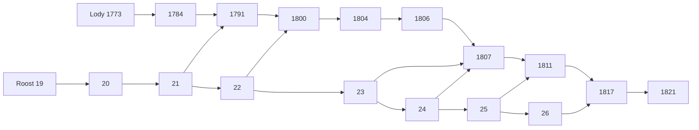

# Roost 与 Lody PR 栈联合审查

Status: proposed
Translation: current

[English](2026-10-22-roost-pr-stack-integration.md)

## 摘要

8 个开放的 Roost PR 和 10 个开放的 Lody PR 组成两条有序依赖链，各自的栈顶已经包含前面的全部改动，重复叠加补丁没有必要。Roost 栈顶已包含最新 main；Lody 栈顶与 main 后续的 27 个提交可以自动合并，但双方都修改了 ACP 历史处理，需要联合行为验证。建议先测试两个完整栈顶与最新 main，再统一发布一版匹配的 Roost，随后更新 Lody 的依赖。当前新 API 尚未发包，使用源码链接的测试通过也不能替代 npm 安装及 CI 验证。

## 范围与源码标识

快照日期：2026-10-22。GitHub PR 元数据、完整 head/base SHA、检查链接及原始日志保存在仓库之外。此次审查没有修改原 PR 分支、发布包或部署状态。

- Roost main：`1b6df6199ca2973efd6912f2e7611ba306e9aaa3`。
- Roost 栈顶 [#26](https://github.com/loro-dev/roost/pull/26)：`d4b07d48d53036da824372d5531f41da1fce02d2`。
- Lody main：`957b513ee391c5b69101ae3d22ee353f1d6f4b20`。
- Lody 栈顶 [#1821](https://github.com/LodyAI/Lody/pull/1821)：`d494724c30e4389148b81762162436d0b6063450`。
- Lody 共同祖先：`a8cffe6f1be2a7b6983770afdebe5231b0a7ae10`。
- 独立克隆中的本地集成分支：`codex/roost-stack-integration`。初始合并源码树：`d6aca152c66e6356e8150c2c60affc1c62213f9c`。

此次工作审查依赖与集成，不构成重新逐行证明全部实现正确，也不产生新的性能结论。既有 benchmark 的口径与缺失项目继续遵循[验证指南](../../../docs/roost-validation.md)及其关联报告。

## PR 清单及顺序

以下 PR 在快照时均开放。Roost #19 非草稿，其他 17 个为草稿。每一条链中，前一个 head 都是后一个 head 的祖先。跨仓库依赖指所需 API 或配套 SDK 优化。

| PR                                                     | 职责                               | 前置依赖             | Head           |
| ------------------------------------------------------ | ---------------------------------- | -------------------- | -------------- |
| Roost [#19](https://github.com/loro-dev/roost/pull/19) | 有界小子树内联，减少投影行         | main                 | `0f81d7b12960` |
| Roost [#20](https://github.com/loro-dev/roost/pull/20) | 去掉 Native 不使用的 outbox 副本   | #19                  | `60f6b160cfc0` |
| Roost [#21](https://github.com/loro-dev/roost/pull/21) | 紧凑事件与原子本地提交元数据       | #20                  | `4afe55a11d62` |
| Roost [#22](https://github.com/loro-dev/roost/pull/22) | 有界压缩日志块，最终容器 v9        | #21                  | `3068595c7b31` |
| Roost [#23](https://github.com/loro-dev/roost/pull/23) | 有界已封存正文缓存                 | #22                  | `c40524ae7a52` |
| Roost [#24](https://github.com/loro-dev/roost/pull/24) | 减少重复历史追赶往返               | #23                  | `f4cc6b837eb2` |
| Roost [#25](https://github.com/loro-dev/roost/pull/25) | 条件原子派生检查点                 | #24                  | `ff1a639f930c` |
| Roost [#26](https://github.com/loro-dev/roost/pull/26) | 复用私有检查点及分支目录证据       | #25                  | `d4b07d48d530` |
| Lody [#1773](https://github.com/LodyAI/Lody/pull/1773) | 紧凑 Agent 重放收据                | main                 | `ce653a2199e9` |
| Lody [#1784](https://github.com/LodyAI/Lody/pull/1784) | 紧凑渲染端变更收据                 | #1773                | `e920a7830d4e` |
| Lody [#1791](https://github.com/LodyAI/Lody/pull/1791) | 内容和渲染元数据原子提交           | #1784；Roost #21     | `061460cb7406` |
| Lody [#1800](https://github.com/LodyAI/Lody/pull/1800) | 压缩存储下的契约断言               | #1791；Roost #22     | `8e3375961a77` |
| Lody [#1804](https://github.com/LodyAI/Lody/pull/1804) | 复用未变 owner 投影                | #1800                | `2cfda8cfd2dd` |
| Lody [#1806](https://github.com/LodyAI/Lody/pull/1806) | 安装经证明的文本投影               | #1804                | `af7e50bf7442` |
| Lody [#1807](https://github.com/LodyAI/Lody/pull/1807) | 复用封存投影，减少封存后的整窗读取 | #1806；Roost #23/#24 | `bab14a8f424c` |
| Lody [#1811](https://github.com/LodyAI/Lody/pull/1811) | 合并内容、SDK 进度与暂存 goal 提交 | #1807；Roost #25     | `f06b820f3628` |
| Lody [#1817](https://github.com/LodyAI/Lody/pull/1817) | 语义变更贯穿私有投影               | #1811；Roost #26     | `435148029bff` |
| Lody [#1821](https://github.com/LodyAI/Lody/pull/1821) | 标量索引调度，避免读取完整历史     | #1817                | `d494724c30e4` |

Roost #15–#18、Lody #1735/#1737/#1765 已合并，无需再次应用。Lody [#1483](https://github.com/LodyAI/Lody/pull/1483) 只删除未使用的 `readGoalProjection` import：当前 main 已没有该 import，新栈则在行为测试中使用它。这条旧清理已过时，不应套入新栈。此次没有关闭 PR。

## 冲突判断

- Roost 有 14 个栈独有提交，没有 main 独有提交；栈顶已包含 main，8 个 PR 的相邻 head 祖先关系全部成立。
- Lody 有 24 个栈独有提交、27 个 main 独有提交；10 个 PR 的相邻 head 祖先关系全部成立。实际执行本地 `merge --no-commit --no-ff` 无需手动解决冲突。
- 双方同时修改的文件有三个：`AGENTS.md`、`session-execution-service.ts`、共享 `acp/history-apply.ts`。
- 合并保留 main 的 Node 安全版本下限；使用 Node 24.22.1 验证，没有绕过运行时检查。
- 会话执行同时保留 main 的原始用户文本标题、Inbox 准入/恢复和脱离 turn 等待的 Code Collab 刷新，也保留新栈无正文的待处理输入读取。
- main #1805 为根工具及标准化子工具统一有界存储投影。新栈不可变规划器调用同一个 `NotificationOnHistoryApplier`，因此必须保留新投影并正确追踪变更。现有子工具、存储策略和不可变规划测试共同覆盖这个交界。

首次文档检查还发现一处实际组合门禁冲突：根 `AGENTS.md` 在 main 为 8,137 字节，在栈顶为 8,185 字节，各自都未越界，但合并后达到 8,230，超过 8,192 字节上限。新增的根级 Roost 报告规则没有必要：现有验证指南已经承载所要求的报告规范。本地集成副本删除该新增规则，完整保留 main 的原始说明，包括 Node 安全版本下限，大小为 8,137 字节；没有新产品需求需要再增加一条根规则。这项纯文档处理没有写回现有 PR 分支。

Native 事务、SDK 检查点、Lody owner 投影及历史契约测试被后续 PR 多次修改，是有意依赖，不是需要二选一的独立补丁。Git 无文本冲突不能证明事务、证明条件、重试和恢复都正确。GitHub 的 MERGEABLE 只针对各 PR 声明的父分支，不代表整栈与 main 已验证。Lody #1800 是必须保留的测试适配，不是另一项运行时优化：Roost #22 压缩日志行后，旧测试直接扫描 SQLite 内部行已不能证明保留更新被完整覆盖。

## 当前 CI 与发布阻塞

Roost #26 的 Rust/SDK 检查及全部 6 平台 Native 构建测试通过。剩余的[发布准备任务](https://github.com/loro-dev/roost/actions/runs/39726241452/job/119653660877)失败，是 npm dry-run 拒绝复用已发布的 `0.2.0`。#23/#24 较早的平台失败属于不同原因：已下载的日志显示 npm/pnpm 下载超时或 HTTP 503，并非运行时断言失败。

Lody [#1821 静态检查](https://github.com/LodyAI/Lody/actions/runs/39758120547/job/119755205267)及[桌面 smoke 构建](https://github.com/LodyAI/Lody/actions/runs/39758120634/job/119755252945)缺失 `readCommitMetadata`、`annotateCommit`、`commitMetadataAfter`、`commitContentBatch`、`advanceActiveBranchDirectory` 及 Native 能力类型。锁文件仍安装已发布的 0.2.0；从 #1791 起存在这个发布依赖，#1773/#1784 自身 head 没有出现同类失败。源码链接仅是本地测试设置，不能代替可安装的发布包或修复 CI。

最终组合 Rust 存储只接受全新数据库或容器 v9，npm 0.2.0 使用 v4。没有迁移、自动删除和旧格式 reader；旧数据必须保留匹配的旧运行时。此前同意实验数据可以重建，并不授权删除任何在线数据库。复制使用的 wire v1 与本地容器变化分开判断。

## 联合验证

已在 Node 24.22.1、pnpm 10.20.0 下完成最新 main 合并依赖的 frozen 安装。仅替换本克隆的 CLI Roost 依赖链接，共享包解析到合并克隆内部。初次运行时检查使用构建的 SDK/Native 源码包，最终 Native 接入检查使用安装后的候选 tarball。Native 和 SDK 从固定 Roost 栈顶重新构建；addon SHA-256 为 `524c5497695dc4e2502d60aa0b6419d0cc6cf35bb30cccb8b7b5cc8df52b3ced`，完整构建输入清单保存在仓库之外。

| 检查                                                        | 组合源码结果                   |
| ----------------------------------------------------------- | ------------------------------ |
| SDK 类型检查及构建                                          | 通过                           |
| Native 完整 `npm test`，含存储/恢复、同步及发布单元 fixture | 59 项通过，零跳过              |
| SDK 历史测试，含 Chromium、WebKit、进程 host                | 164 项通过，零跳过             |
| Lody 根检查                                                 | 运行中；全部工作区类型检查通过 |
| 根格式化与最终文档检查                                      | 待最终执行                     |

初次 Native 测试误用缺少构建来源证明的旧相邻 addon，协议检查失败；已排除该次运行并保留日志。重建后，先通过真实 SDK 写入/重开探针再执行完整测试。直接运行发布单元文件也缺失 npm fixture 环境，以表格中的完整 `npm test` 为有效结果。Kimi/Pi 源码子模块未初始化还导致链接检查失败，补齐精确指针后消除；没有安装或消费它们的运行时。这些是环境准备修正，不作产品回归判断；验证指南已补充二进制来源及 npm fixture 的要求。

最初的完整 `pnpm check` 返回失败，是因为 3 项 Electron 打包 fixture 需要已安装的 host 平台包，源码链接不包含该布局；此次没有因此修改运行时实现。从 [Roost #26 CI](https://github.com/loro-dev/roost/actions/runs/39726241452) 下载了 6 个真实平台产物，使用既有发布脚本组装。其 PR merge 提交 `6ef36e4cc242ad5fe4f5da06202feea93eba7dd3` 与 Roost 栈顶的源码树完全一致，均为 `6e395f1d8f8d9ccdf2f2cd86b639cf2c728b4a1f`。私有离线安装仅选中 main 和 darwin-arm64；其 addon SHA-256 为 `cd399a4a7ad7d3483c222cae048ff46473dcc708ae9ced4df21bb7c27418e324`。替换本克隆的 Native 链接后，完整 Electron 测试和 8 个 CLI 归属文件通过；根脚本在 test 之后的每项检查均另行执行并通过，已成功的无关测试没有重复。原始根检查失败日志完整保留，没有标成命令整体成功。其他根测试跳过为 RPC 3 项、platform 1 项。桌面应用 E2E/构建及 registry 版本安装仍属于发布阶段门禁。

此次只有合并审查，没有新的性能改动，因此不重复 benchmark；先前报告也不升级为完整恢复或网络结果。平台 CI 和本次源码链接测试不能替代发布后干净 registry 安装的接入验证。

## 建议落地流程

1. 保留各 PR 的审查边界，先联合测试完整栈顶与最新 main。不要向栈顶重复 cherry-pick 每个 PR，也不需要把中间容器版本投入生产。
2. 解决实际联合失败后再改变草稿/审查状态；任一 main 或栈顶变化都重新确认源码标识。
3. Roost 按依赖从底向上合并，统一准备一版匹配的 core/SDK/Native，要求 6 平台打包及发布检查通过。后续 PR 当前指向父分支，父项落地后应改为指向 main。两个仓库都允许 merge commit、squash、rebase，且不会自动删除已合并分支；保留祖先关系的 merge commit 能保持后续 diff 简单，使用 squash 则需要重新整理后续栈，不能只修改 base 名称。发布需要负责人明确授权。
4. 在最早使用新 API 的 Lody #1791 同时更新精确 SDK/Native 版本、catalog 放行项及 lockfile，并把该版本与 #1800 的压缩存储断言传播到后续栈；只更新 #1821 会让前面的接入 PR 继续安装 0.2.0 而 CI 失败。用 registry 包重新 frozen 安装，执行静态检查、CLI/桌面构建和关联集成测试，不依赖源码链接。
5. Lody 从底向上合并，或审查后另行决定整合 PR；然后通过正常 CI 更新私有 staging 的 OSS 指针。staging 部署和调试 CLI 替换仍是另外的授权步骤。

保留原栈便于逐项审查、定位回归；压成两个大 PR 可以减少落地队列，但会增大存储/事务与接入改动的单次审查范围。压 PR 是可选管理动作，完整联合测试不依赖它。
